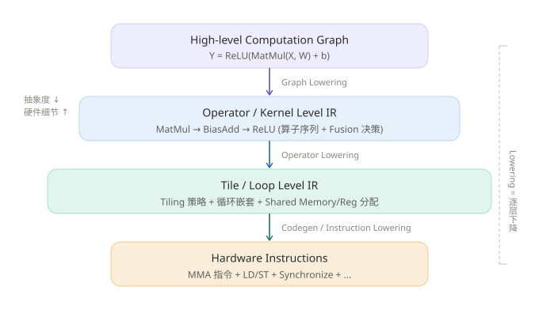
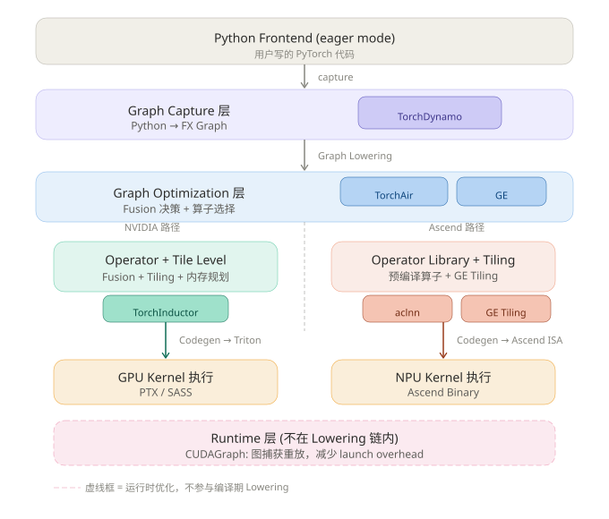

# PyTorch 编译栈与 Lowering 层次映射

## 场景引入

你一定见过这几个名字：Dynamo、Inductor、CUDAGraph、TorchAir、GE、aclnn……它们在 PyTorch 的编译和推理流程中各司其职，但互相之间的关系是什么？谁在做 2026-06-23_lowering？谁只是个运行时优化？

这篇讲解把 PyTorch 编译栈的组件，精确映射到 2026-06-23_lowering 的三层模型上，让你一眼看清每个组件"住"在哪一层。

## 前置概念解释

- **2026-06-23_lowering**：编译器将高抽象表示逐步降低到低抽象表示的过程。分三级：Graph Lowering → Operator Lowering → Instruction Lowering
- **Fusion/Tiling/Layout**：AI 编译器的三大核心优化维度，分别在 lowering 的不同阶段发挥作用
- **FX Graph**：PyTorch 的中间表示，由 Dynamo 从 Python 代码中捕获
- **Triton**：OpenAI 开发的 GPU kernel DSL，Inductor 的代码生成目标
- **Triton 编译器**：将 Triton Python 代码编译为 PTX，再由 NVIDIA 驱动编译为 SASS（GPU 可执行二进制）
- **GE（Graph Engine）**：华为昇腾的图编译引擎
- **aclnn**：昇腾算子库（Ascend Computing Library for Neural Network），类似 NVIDIA 的 cuDNN/cuBLAS

## 核心讲解

### Lowering 的三层模型

在深入 PyTorch 组件之前，先理解 lowering 的完整层次结构：



**核心洞察**：Lowering 不是一步到位的映射，而是"逐层下降"的流水线，每一层都引入更多硬件细节（存储层次、并行结构、指令集）。

### PyTorch 组件的精确映射

下面这张图展示了 PyTorch 编译栈的 7 个组件分别落在 lowering 层次的哪个位置：



### 结论先行：七组件三分类

PyTorch 编译栈的 7 个组件，可以分为三大类：

1. **做 Lowering 的**：Inductor（NVIDIA 路径）、GE（Ascend 路径）—— 它们是编译的"重活担当"
2. **做 Graph Capture 的**：Dynamo、AOTAutograd、TorchAir —— 它们是 lowering 的"起点"或"桥梁"
3. **不做 Lowering 的**：aclnn（预编译产物）、CUDAGraph（运行时优化）

### 逐组件拆解

#### 1. TorchDynamo → Graph Capture 层（Lowering 之前）

**做什么**：用 CPython 的 Frame Evaluation API hook 进 Python 字节码，把 `torch.add`、`torch.matmul` 这些调用捕获成 FX Graph。

**不做 Lowering**：Dynamo 做的是 **lift**（提升），把 Python 动态语义"提升"成一张静态图。它是 lowering 的**起点**，但本身不是 lowering。

**类比**：Dynamo 像一个速记员——你口述 Python 代码，它记录成一张"谁连着谁"的计算图。速记员不理解计算的含义，只记录结构。

#### 2. AOTAutograd → Graph Capture 层的辅助

**做什么**：在 Dynamo 捕获前向图之后，用 `torch.autograd` 的 trace 机制推导出反向计算图，把前向+反向合并成一个大的 FX Graph，再交给 Inductor。

**不做 Lowering**：它是在 Graph Capture 层做**图的补全**——没有它，Inductor 只能看到前向图，不知道反向怎么算。

**类比**：AOTAutograd 像一个"补画师"——你画了前半幅画，它根据画法规则自动补出后半幅。

#### 3. TorchInductor → Graph + Operator + Codegen 全链路

**做什么**：整个编译栈的"重活担当"，覆盖了 lowering 的三个阶段：

| 阶段 | Inductor 做的事 | 对应 Lowering 层 |
|---|---|---|
| Graph Lowering | FX Graph → Loop-level IR（`sched.HardwareBuffer`、`sched.IRNode`），做 fusion 决策 | Graph Lowering |
| Operator Lowering | 融合后的 IR → 循环嵌套展开、tile 大小选择、memory planning | Operator Lowering |
| Codegen | IR → **Triton kernel 代码**（NVIDIA）或 **C++ 模板**（CPU） | Instruction Lowering |

**关键特征**：Inductor 是 **JIT 生成 kernel**——它不是调用预编译的算子，而是根据当前输入的 shape 动态生成代码。这意味着 fusion 的边界可以灵活打破。

#### Inductor 的 Codegen 输出 ≠ PTX

这里有一个常见的误解：Inductor 生成的是 **Triton Python 代码**，不是 PTX。

**完整链路**：

```
Inductor IR  
    ↓ Codegen
Triton Python 代码  ← Inductor 的输出边界在这里
    ↓ Triton 编译器（运行时 JIT）
Triton IR (MLIR dialect)
    ↓ 优化（tiling、shared memory）
LLVM IR
    ↓ LLVM 后端
PTX (Parallel Thread Execution)
    ↓ NVIDIA 驱动 JIT
SASS (最终 GPU 执行的二进制)
```

**两层 JIT**：
1. **Inductor JIT**（编译期）：生成 Triton Python 代码
2. **Triton JIT**（运行时）：Triton 编译器把 Python 代码编译为 PTX/SASS

> [!insight] 为什么 Inductor 不直接生成 PTX？
> - **灵活性**：Triton 是更高层抽象，Inductor 专注算子融合、tiling 策略等高层优化，不用关心寄存器分配、指令调度
> - **可移植性**：Triton 编译器可以编译到 NVIDIA/AMD/Intel 等不同后端
> - **迭代速度**：Triton 编译器独立演进，新硬件支持不需要改 Inductor

实际部署中，Inductor 配合 **compile cache**——首次编译后缓存 Triton 生成的 `.cubin`（SASS 二进制），后续直接加载，跳过 Triton 编译步骤。这也是为什么你可能误以为 Inductor 直接生成了 SASS。

#### 4. TorchAir + GE → Ascend 路径的 Graph Optimization

**做什么**：

- **TorchAir**：把 Dynamo 导出的 FX Graph 转成昇腾的图 IR，喂给 GE
- **GE**：华为昇腾的图编译器，做算子融合、内存规划、tiling 策略选择，然后调度 aclnn 算子执行

**与 Inductor 的对比**：

| 维度 | Inductor（NVIDIA） | GE（Ascend） |
|---|---|---|
| Fusion 方式 | JIT 生成新 kernel，可灵活打破算子边界 | 调用预编译的 aclnn 算子，受限于算子库的边界 |
| Tiling | 自动搜索 tile 大小 | GE 内置 tiling 策略 + auto-tuning |
| Codegen | 生成 Triton 代码 → 编译为 PTX | 选择 aclnn 算子 + 传参 |
| 灵活性 | 高（任意算子组合） | 受限于 aclnn 算子库覆盖 |

#### 5. aclnn → 预编译算子库（Lowering 的"终点产物"）

**做什么**：华为昇腾的算子库，类似 NVIDIA 的 cuDNN/cuBLAS。

**不做 Lowering**：aclnn 是 lowering 的**终点产物**之一。GE 在做 Graph Optimization 时决定调用哪个 aclnn 算子、传什么参数，但 aclnn 本身是已经编译好的二进制。

> [!insight] JIT vs 预编译的本质区别
> Inductor 是 JIT 生成 kernel 代码 → fusion 可以打破算子边界，灵活组合。
> aclnn 是调预编译好的 kernel → fusion 的边界被算子库的 API 边界锁死，只能组合已有的算子。
> 这就像：JIT 是"现炒"，想加什么料随时加；预编译是"点菜"，只能选菜单上有的组合。

#### 6. CUDAGraph → Runtime 层（完全不在 Lowering 链上）

**做什么**：把一系列 CUDA kernel launch 捕获成一个图，然后一次性提交给 GPU 执行，消除 CPU-GPU 之间的 launch overhead。

**不做 Lowering**：它跟编译期的 lowering 没有任何关系——它是在**运行时**把已经编译好的 kernel 串重新组织执行顺序。对应文章里说的"Runtime 层：暴露 stream、event、graph"。

**类比**：CUDAGraph 像一个"快递分拣站"——快递（kernel）已经打包好了，它只负责按最优路线一次发出，不改变包裹内容。

#### 7. AOTAutograd → Graph Capture 层的辅助

**做什么**：在 Dynamo 捕获前向图之后，用 `torch.autograd` 的 trace 机制推导出反向计算图，把前向+反向合并成一个大的 FX Graph，再交给 Inductor。

**不做 Lowering**：它是在 Graph Capture 层做**图的补全**——没有它，Inductor 只能看到前向图，不知道反向怎么算。

**类比**：AOTAutograd 像一个"补画师"——你画了前半幅画，它根据画法规则自动补出后半幅。

### 手写 Triton 与 Inductor 自动生成的关系

前面讲了 Inductor 自动生成 Triton 代码，那既然能自动生成，为什么还有人直接手写 Triton kernel？（比如 Tri Dao 在 FlashAttention 2 中手写 Triton）

这涉及 **Triton 作为编译器后端** 与 **Triton 作为 Kernel DSL** 两种使用方式。

#### 两种使用方式

| 维度 | Inductor 自动生成（方式一） | 手写 Triton（方式二） |
|---|---|---|
| 你写的代码 | PyTorch Python | Triton Python |
| tiling/shmem 控制 | Inductor 决定 | **你决定** |
| 适用场景 | 90% 标准模型 | 创新算子、极致优化、研究 |
| 开发速度 | 快 | 慢（需理解 GPU 编程） |
| 性能天花板 | 中上（自动优化有局限） | 高（完全控制） |

#### 为什么手写？

1. **创新算子**：Inductor 能自动识别的 fusion pattern 是有限的。当你发明了一个全新的算子（如 FlashAttention 的 attention 融合方式），Inductor 根本不知道这种 pattern，必须手写 Triton kernel 来探索和实现。
2. **极致优化**：某些场景需要手工微调 tiling 策略、shared memory 使用方式，才能达到硬件极限。Inductor 的 auto-tuning 搜索空间大，但搜索不到"还没人告诉你"的最优策略。
3. **研究价值**：手写 Triton 是理解 GPU 并行编程的必经之路。新的设计经验证有效后，可能被社区吸收，最终成为 Inductor 能自动生成的 pattern——**创新先从手写开始，再被自动编译器吸收**。

#### 从 FlashAttention 的演进看

```
FlashAttention v1/v2：手写 CUDA kernel（极致优化）
    ↓
FlashAttention v2 Triton 版：手写 Triton kernel（研究+可移植）
    ↓
2024 年后：社区 patch 进入 PyTorch，Inductor 开始支持类似 pattern（"标准化"后自动生成）
```

**本质规律**：先有手写实现证明可行性，再被自动编译器吸收为标准 pattern。所以手写 Triton 不会消失——它是**创新的入口**。

#### Triton 与 CUDA 的对比

为什么手写 Triton，不直接手写 CUDA？

| 维度 | CUDA (Thread-Level) | Triton (Block-Level) |
|---|---|---|
| 代码粒度 | 单个 thread 的逻辑 | **单个 Block 的逻辑** |
| Tiling 控制 | 手动 | 手动决定，编译器优化细节 |
| Shared Memory | 手动分配+显式同步 | 请求使用量，编译器自动管理 |
| Thread Index | 手动计算 `blockIdx.x * blockDim.x + threadIdx.x` | **不用管** |
| Warp 同步 | 手动 `__syncthreads()` | **自动** |
| Register 分配 | 手动优化避免 spill | **编译器自动** |
| 代码量 | 几百行 | 几十行（约为 CUDA 的 1/5~1/10） |

**核心洞察**：
> **Triton = Block-Level 编程 + 自动 Thread-Level 优化**
> 你只需要写"一个 Block 做什么"——数据如何分块、Block 内的计算逻辑、Shared Memory 的使用量。Triton 编译器负责把 Block 逻辑分解到每个 thread，做寄存器分配、指令调度、bank conflict 优化。

如果你想深入了解 Triton 的 Block-Level 编程细节，参见 2026-06-23_triton_programming_model。

## 总结映射表

| 组件 | 对应层次 | 做 Lowering 吗？ | 本质 |
|---|---|---|---|
| **Dynamo** | Graph Capture | 不做，是起点 | Python → FX Graph |
| **AOTAutograd** | Graph Capture 辅助 | 不做 | 补全反向图 |
| **Inductor** | Graph + Operator + Codegen | **做，全链路** | FX Graph → Triton/C++ |
| **TorchAir** | Graph Optimization (Ascend) | 做 Graph Lowering | FX Graph → 昇腾图 IR |
| **GE** | Graph + Operator (Ascend) | **做，全链路** | 图 IR → 算子调度 + tiling |
| **aclnn** | 算子库 | 不做，是产物 | 预编译好的 kernel 二进制 |
| **CUDAGraph** | Runtime | 不做 | 捕获重放已编译的 kernel |

## 多角度追问

> [!question] Inductor 做 JIT 生成 kernel，那编译耗时怎么办？
> Inductor 的首次编译确实很慢（可能几十秒到几分钟），所以实际部署中通常配合 **compile cache**——编译一次后缓存 Triton 生成的 .cubin 文件，后续直接加载。这是 JIT 编译的通用 trade-off：用首次编译时间换运行时最优性能。

> [!question] aclnn 的"预编译算子"能不能做 fusion？
> 有限度地可以——aclnn 支持一些"融合算子"（如 MatMul + Bias + ReLU 打包成一个算子），但这些融合是**算子库作者预先定义好的**，不是运行时动态决定的。如果需要的组合不在算子库里，就只能拆成多次调用。这和 Inductor 的"任意组合"形成鲜明对比。

> [!question] 如果我要在 Ascend 上做 Inductor 那样的 JIT fusion，有可能吗？
> 理论上可以——你可以不调 aclnn，而是用 Ascend 的底层 DSL（如 Ascend C）自己写 kernel。但这就失去了 aclnn 的"开箱即用"优势，开发成本极高。目前社区中 Ascend 路径的主流选择仍然是 GE + aclnn。

## 边界与极端情况

- **Dynamo graph break**：当 Dynamo 遇到无法捕获的 Python 代码（如 data-dependent control flow），会触发 "graph break"，把图切成多段，中间回退到 eager 模式。这会导致无法做跨段的 fusion
- **Inductor 的 fallback**：某些算子 Inductor 无法生成 Triton 代码，会 fallback 到调用 ATen kernel（相当于没有做 fusion 优化）
- **CUDAGraph 的限制**：捕获后的图不能包含动态 shape、动态控制流，否则无法重放

## 参考文献 & 延展学习

| 来源 | 类型 | 难度 | 链接 |
|---|---|---|---|
| PyTorch 2.0 编译技术博客 | blog | beginner | https://pytorch.org/get-started/pytorch-2.0/ |
| TorchDynamo 深度解析 | blog | intermediate | https://dev-discuss.pytorch.org/t/torchdynamo-deep-dive/ |
| TorchInductor 架构设计 | 设计文档 | advanced | https://dev-discuss.pytorch.org/t/torchinductor-a-pytorch-native-compiler-with-define-by-run-ir-and-symbolic-shapes/ |
| 从 Fusion、Tiling、Layout 来看 AI 时代的计算范式变革 | 知乎 | intermediate | https://zhuanlan.zhihu.com/p/2035814498754372533 |
| MLIR 多层次 IR 设计 | 技术文档 | advanced | https://mlir.llvm.org/ |
