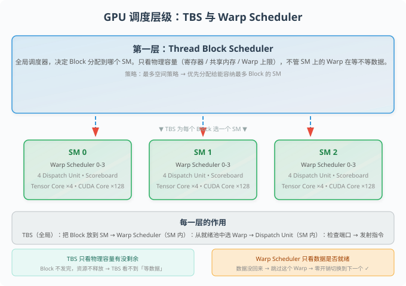

# GPU 调度深潜

> TBS（Thread Block Scheduler）与 Warp Scheduler 两层调度机制，从 Block 分配到指令发射，一次全部讲清楚。
> 来源：知乎文章 [GPU 架构与 CUDA 编程](https://zhuanlan.zhihu.com/p/1937580325774526286) + Maxwell 的深度追问。
> 涵盖：TBS、Warp Scheduler、Occupancy、SM Utilization、Dispatch Unit、Port Arbitration、Scoreboard 等核心概念。

---

## 场景引入：你写了 1000 个 Block，GPU 怎么决定谁先跑？

想象一下：你 launch 了一个 kernel，指定了 1000 个 block。但你的 GPU 只有 80 个 SM（Streaming Multiprocessor）。问题来了——

> 哪 80 个 block 先上？剩下的 920 个在哪等？上了的 block 什么时候下班？

这就是 TBS（Thread Block Scheduler）的工作。但它不是唯一的调度器——每个 SM 内部还有一个更微型的 Warp Scheduler，负责从驻留的 Warp 中挑「就绪」的来执行。

两层调度，一层管「块分配」，一层管「指令分派」。把它们搞清楚的唯一方法是——**一层层拆，别跳过任何一个。**

---

## 前置概念解释

在开始之前，确保下面这些术语你知道。如果哪个不清楚，先看 `GPU 硬件调度` 和 `2026-06-23_triton_programming_model`，回头再来看。

### 核心术语速查

| 术语                   | 含义                                             | 负责任务                              |
| -------------------- | ---------------------------------------------- | --------------------------------- |
| **TBS**              | Thread Block Scheduler，在 GPU 全局层面分配 Block 到 SM | 决定 Block 放哪个 SM                   |
| **Warp Scheduler**   | SM 内部的指令调度器，每个 SM 有 4 个                        | 从驻留 Warp 中选择就绪的 Warp 执行指令         |
| **Dispatch Unit**    | 每个 Warp Scheduler 的下游，负责真正把指令发给计算单元            | 取指令 \u2192 检查端口 \u2192 发射         |
| **Scoreboard**       | Warp 内部的硬件标记表，记录每个 Warp 的数据依赖是否已解决             | 标记 Warp 是否「就绪」、数据是否已到             |
| **Port Arbitration** | 当多个 Dispatch Unit 想用同一个计算单元时，仲裁谁先用             | 避免多个指令冲撞同一个 Tensor Core/CUDA Core |
| **Occupancy**        | SM 上驻留 Warp 数 / 最大可驻留 Warp 数                   | 衡量「延迟隐藏空间」有多大                     |
| **SM Utilization**   | SM 的计算单元有多少时间在真正干活                             | 衡量延迟隐藏做得怎么样                       |

### 关键框图：SM 内部结构

### 关键对比：TBS 资源可用 vs Warp 就绪

| 维度 | TBS「资源可用」 | Warp Scheduler「就绪」 |
|---|---|---|
| 谁在看 | TBS（全局调度器） | Warp Scheduler（SM 内部） |
| 看什么 | SM 的物理容量是否还有剩余（寄存器、共享内存、Warp/Block上限） | 当前 Warp 的指令操作数的数据依赖是否已解决 |
| Warp 在等数据 | 资源已占用，不影响 | 「不就绪」，被跳过，切换到下一个 |
| Block 执行完毕 | 资源释放，可接纳新 Block | 该 Block 的 Warp 已全部退出 |
| 关系 | 两者完全独立，互不干扰 | 一个看物理容量，一个看数据依赖 |
| 关键结论 | TBS 不看 Warp 在干什么 | 只看「能不能塞更多」 |

### Occupancy 与 SM Utilization 的对比

| 维度 | Occupancy（占用率） | SM Utilization（利用率） |
|---|---|---|
| 衡量什么 | SM 上驻留了多少 Warp（静态容量） | SM 的计算单元有多少时间在真正干活（动态效率） |
| Warp 在等数据 | 算！占着资源就算 | 不算！计算单元闲着 |
| 上限 | 硬件限制（寄存器、共享内存、Warp 上限） | 理论上可以 100% |
| 跟性能的关系 | 高 \u2260 一定快，低 \u2260 一定慢 | 高 \u2248 快（前提是 Occupancy 够） |
| 关键洞察 | 为「延迟隐藏」提供前提条件——得塞够 Warp 才能有机会隐藏延迟 | 衡量延迟隐藏做得怎么样的结果指标 |

### 一个 Block 能否跨两个 SM？

> [!important] 不能！
> Block 内的所有线程共享同一块 `__shared__` 内存，需要 `__syncthreads()` 同步。
> 如果把 Block 拆到两个 SM 上，共享内存和线程同步全都断掉，CUDA 编程模型直接崩。
> **一 Block 一 SM，永远如此。**

### 4 个 Dispatch Unit 和 4 个 Tensor Core 是什么关系？

> [!warning] 关键纠正
> **不是一一映射！** Dispatch Unit 不直接连到固定的 Tensor Core。它们通过 Crossbar / 分级总线网络连接到多个执行单元。这就像「4 个服务员对着一个共享的备餐台发订单」，而不是「4 个服务员各自独占 1 个炉灶」。

---

## 核心讲解：两层调度机制

### 第一层：TBS（Thread Block Scheduler）

**TBS 的工作：把 Block 分配给 SM。**

- **决策依据**：SM 的物理容量（寄存器文件大小、共享内存大小、最大可驻留 Warp 数 / Block 数）
- **策略**：「最多空间策略」——优先把 Block 分配给能容纳最多 Block 的 SM
- **关键细节**：一个 Block 被分配到 SM 后，其所有资源（寄存器、共享内存）都被分配并锁定。无论 Block 里的 Warp 在干什么，这些资源一直占用到 Block 执行完毕才释放

**资源可用怎么判断？**

TBS 在分配时检查的是：**这个 SM 还有没有剩余的容量可以再塞一个 Block**，而不是「这个 SM 上还有没有空闲的 Warp 在等指令」。

> 如果 SM 最多驻留 64 个 Warp，当前已驻留 60 个（分布在多个 Block 中）。新来一个 Block 需要 4 个 Warp。60 + 4 \u2264 64，容量没超，TBS 就会把 Block 安排到这个 SM 上。**即使这 60 个 Warp 全部在等内存数据、没有一个在执行指令，SM 的物理资源已经被分配出去，不会因为「没人执行」就释放掉。**

### 第二层：Warp Scheduler（SM 内部微调度）

**Warp Scheduler 的工作：从驻留的 Warp 中选「就绪」的来执行指令。**

#### 零开销上下文切换

文章里原话说：

> *"一旦一个线程块在 SM 上启动，它的所有 Warp 就一直驻留，直到执行完成。所有 Warp 的上下文（程序计数器 PC、寄存器状态）都已加载到 SM 的硬件中，这些资源和状态会一直保留，直到这个线程块中的所有线程都执行完毕。"*

当一个指令的操作数未就绪（比如 load 还没从全局内存返回），发生一个「上下文切换」——但因为是 **Warp 状态一直在线，切换不需要「保存」和「恢复」，零开销**。

#### 就绪池

每个 SM 有 4 个 Warp Scheduler，每个时钟周期各自从**共享的就绪 Warp 池**中选一个 Warp 发指令。

> [!important] 关键
> 4 个 Scheduler 共享一个就绪池，不是每个 Scheduler 有自己专属的子集。
> 一个 Warp 不挂在任何特定 Scheduler 上——它在就绪池中，被哪个 Scheduler 选中就由哪个发指令。

#### 四种 Warp 调度策略（扩展知识）

| 策略 | 全称 | 行为 | 适用场景 |
|---|---|---|---|
| RR | Round-Robin | 轮流从就绪池中取 Warp | 通用，默认策略 |
| LRF | Least Recently Fetched | 优先取最久没被取过的 Warp | 避免 Warp 饿死 |
| FAIR | Fair | 保证每个 Warp 大致公平的调度机会 | 负载均衡 |
| CAWS | Criticality Aware | 根据 Warp 的关键性（是否在关键路径上）决定优先级 | 优化延迟 |

### 第三层：Dispatch Unit 与 Port Arbitration

每个 Warp Scheduler 有一个下游的 **Dispatch Unit**，负责真正把指令发出去。

**Dispatch Unit \u2192 计算单元的完整流程：**

1. Warp Scheduler 从就绪池中选一个就绪 Warp
2. Dispatch Unit 取出该 Warp 的当前指令（指令中已编码目标操作——OPCODE 决定了要用什么硬件）
3. Dispatch Unit 检查 Scoreboard：**目标计算单元（Tensor Core/CUDA Core/LSU/SFU）的端口是否空闲？**
4. 如果空闲 \u2192 发射指令
5. 如果端口被占用（另一个 Dispatch Unit 也在同时请求同一个单元）\u2192 Port Arbitration 仲裁：**这条指令的发射推迟一个周期**

**关键：这不是「选」计算单元，而是「检查」端口。**

> [!warning] 常见误解纠正
> Dispatch Unit 不是「随机选一个计算单元」。指令的目标硬件在指令编码时就已确定——OPCODE 决定了目标。Dispatch Unit 做的只是检查：「目标端口现在可用吗？」可用就发，不可用就等下个周期。

#### 为什么需要 4 个 Warp Scheduler 而不是 1 个？

每个 Scheduler 包含自己的 Decoder 和 Scoreboard，负责**一条独立的执行路径**。4 个 Scheduler = 4 条独立执行路径，能在同一时钟周期往不同的计算单元发指令。

**4 个 Dispatch Unit 和 4 个 Tensor Core 不是一一映射**——它们通过 Crossbar / 分组总线网络连接。如果两个 Dispatch Unit 同时想用同一个 Tensor Core 的同一个 lane，硬件仲裁电路会把冲突的指令推迟一个周期发射。

---

## 多角度追问（来自 Maxwell 的深度追问）

### 追问 1：两个不同 Kernel 的 Warp 在同一个 SM 上是并行跑还是串行跑？

你的直觉是对的——两个无依赖的 Kernel 的 Warp **可以**在同一个时钟周期并行执行。

前提是：SM 有 4 个 Dispatch Unit，每个时钟周期最多发 4 条 Warp 指令。两个 Kernel 各 2 个 Warp，总共 4 个 Warp，恰好能在一个周期内全部打满（4 \u00d7 32 线程 = 128 个 CUDA Core）。

「交替执行」只发生在 **就绪 Warp 数 > 4**（Dispatch Unit 数量上限）的时候——比如 SM 上驻留了 64 个 Warp，4 个 Dispatch Unit 每周期只能挑 4 个，其他 60 个在就绪池里轮候。

### 追问 2：Warp ID 在 SM 中是跨 Kernel 全局唯一还是 Kernel 内从 0 开始的？

**跨 Kernel 全局唯一。** 不会出现两个 Kernel 的 Warp 拿到相同 ID 的情况。

这意味着：
- 两个不同的 Kernel 在一个 SM 上，它们的 Warp 使用的 CUDA Core lane 不重叠
- 不会因为「Warp ID 相同」导致串行执行
- 硬件调度器基于 Warp ID 分配计算单元 lane，这是硬件保证的

### 追问 3：Occupancy 高但 Utilization 低是什么情况？

如果所有驻留 Warp 都在等数据（比如你的 kernel 全是访存，几乎没计算），那 Occupancy 再高，SM 的执行单元也在闲着。

> **极端场景**：Occupancy = 100%（64 Warp 驻留），但每个 Warp 都在等全局内存 load，没有一条指令能发射。结果是 SM Utilization \u2248 0%。这就是「延迟隐藏空间有，但没用到」的典型情况。

反之，Occupancy 低但 Utilization 高也可能——比如一个 Warp 全是计算密集指令（如矩阵乘法），几乎没有数据依赖等待，SM 的 ALU 一直在跑。

### 追问 4：Port Arbitration 到底是不是「鸽巢定理」？

你是对的——4 个 Dispatch Unit 和 4 个 Tensor Core 之间，存在一种「鸽巢分配」。但不是指「每个 Dispatch Unit 固定连一个 Tensor Core」，而是指：

> **Crossbar 网络让每个 Dispatch Unit 都能访问所有 4 个 Tensor Core，但同一时刻每个 Tensor Core 的一个 warp lane 只能被一个 Dispatch Unit 占用。**

这是物理上的仲裁机制——不是软件锁，是硬件流水线。冲突发生时的处理是「推迟一条指令一个周期」，不是「阻塞整个流水线」。这跟 Warp 的「零开销上下文切换」是一脉相承的设计——状态在线，检查和仲裁都是硬件流水，无需保存任何上下文。

---

## 边界与极端情况

### 场景 1：Block 太「胖」，塞不进任何 SM

如果 Block 需要的共享内存超过任一 SM 的物理上限，TBS 无法分配（报错），kernel 直接启动失败。

### 场景 2：所有 SM 都满，新 Block 等待

新 Block 在 TBS 的队列里等着，直到某个 SM 上的 Block 执行完毕释放资源。这是正常的调度行为。

### 场景 3：两个 Dispatch Unit 同时请求同一个 Tensor Core 的同一个 lane

Port Arbitration 介入：其中一条指令被推迟一个周期。其他 3 个 Dispatch Unit 不受影响。**不阻塞整个流水线，只卡一条指令。** 这就是「零开销冲突处理」——推迟一个周期，下个周期再试。

---

## 关键洞察：整个讨论的认知演进

> [!insight] 核心洞察：从「TBS 资源可用」到「Warp 就绪」到「Dispatch Unit 端口检查」，这是一条从粗到细的三级调度链。

1. TBS（粗调度）：看物理容量，塞 Block。一个 Block 一 SM。
2. Warp Scheduler（中调度）：看数据依赖，选就绪 Warp。所有 Warp 在一个共享就绪池中。
3. Dispatch Unit + Port Arbitration（细调度）：看端口占用，发指令。指令的目标硬件由 OPCODE 决定，不是随机分配。

三者互不干扰，但层层递进。TBS 不看 Warp 在干什么，Warp Scheduler 不看 SM 还有多少空位，Dispatch Unit 不管 Warp 从哪来。

> [!note] Warp ID 的意义
> Warp ID 直接决定了要用的计算单元 lane。这就是为什么冲突可以提前知道并仲裁——不是「指令里有目标 lane 编号」，而是「指令里有 OPCODE，硬件知道选哪个计算单元」。硬件看到 OPCODE 就直接把操作数送到目标 lane。

---

## 延展学习 & 参考文献

| 来源                                            | 类型    | 难度           | 链接                                                                                           | 关系                                     |
| --------------------------------------------- | ----- | ------------ | -------------------------------------------------------------------------------------------- | -------------------------------------- |
| GPU 架构与 CUDA 编程（知乎文章）                         | blog  | intermediate | [zhuanlan.zhihu.com/p/1937580325774526286](https://zhuanlan.zhihu.com/p/1937580325774526286) | 本帖主要来源                                 |
| 杨轶凡：GPU 架构与 CUDA 编程（第二篇）                      | blog  | intermediate | [zhuanlan.zhihu.com/p/1932035570852430148](https://zhuanlan.zhihu.com/p/1932035570852430148) | 补充阅读（SM 内部结构图示）                        |
| GPU 硬件调度                                  | wiki  | intermediate | 概念页                                                                                          | 本页的配套概念页（TBS + Warp Scheduler 基础）      |
| 2026-06-24_occupancy                                 | wiki  | intermediate | 概念页                                                                                          | 本页的配套概念页（Occupancy vs Utilization 详解）  |
| 2026-06-23_triton_programming_model                  | wiki  | intermediate | 概念页                                                                                          | Triton Block-Level 编程模型（Block 分配的上层视角） |
| NVIDIA Ampere Architecture Whitepaper         | paper | advanced     | —                                                                                            | Warp Scheduler 硬件设计的官方文档               |
| CUDA C++ Programming Guide — Thread Hierarchy | docs  | beginner     | —                                                                                            | CUDA 官方文档：Block/Warp/Thread 的关系        |
